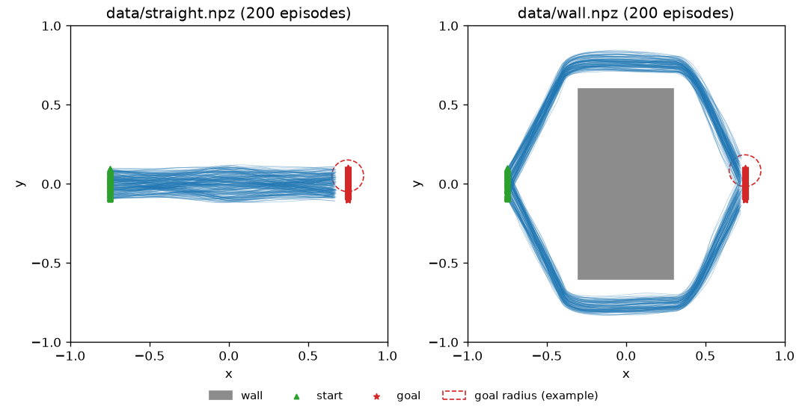

# 課題 1: 模倣学習

## 1. 概要

2 次元平面上の点を start から goal まで移動させるタスクについて、人が操作したデモンストレーションを模して作成したデータセットから、模倣学習で方策を学習しました。
タスク (データセット) は 2 種類、モデルは 2 種類あり、計 4 種類の学習済みモデルを用意しています。

あなたはこれらの学習済みモデルを評価する担当者です。以下の前提をもとに、課題に取り組んでください。

## 2. 前提

### 2.1. 環境 (`env.py`)

| 項目 | 内容 |
| --- | --- |
| 平面 | x, y ともに `[-1, 1]` の正方形。外枠からはみ出す場合は枠内に押し戻される |
| start | `(-0.75, y)`。`y` は `[-0.1, 0.1]` から一様に選ばれる。t = 0 で点は start にある |
| goal | `(0.75, y)`。`y` は `[-0.1, 0.1]` から一様に選ばれる。goal から距離 `0.1` 以内に入ると到達 |
| 観測 | 点の現在位置と goal の位置 `[x, y, goal_x, goal_y]` |
| 行動 | 2 次元の速度 `[vx, vy]` (連続値)。ノルムが上限 `0.6` を超える場合は `0.6` に縮められる |
| 時間刻み | 1 ステップあたり `Δt = 0.05`。位置は `p ← p + v Δt` で更新される |
| エピソード終了 | goal に到達 / 壁に衝突 / 200 ステップ経過 のいずれか |

レイアウトは以下の 2 種類です。

- `straight`: 障害物なし
- `wall`: 平面の中央に壁 (`-0.3 ≤ x ≤ 0.3`, `-0.6 ≤ y ≤ 0.6`) がある。壁に入るとエピソードは終了する

`env.step()` は `(obs, done, info)` を返し、`info` には `success` (goal に到達したか)、`collision` (壁に衝突したか)、`t` (経過ステップ数) が含まれます。

### 2.2. データセット (`data/`)

| ファイル | 内容 |
| --- | --- |
| `data/straight.npz` | `straight` レイアウトで、真ん中付近を比較的まっすぐ進んで goal に向かうデモ 200 エピソード |
| `data/wall.npz` | `wall` レイアウトで、壁を迂回して goal に向かうデモ 200 エピソード |

各データセットの全エピソードの軌道を以下に示します (青線: 軌道、緑の三角: start、赤の星: goal、破線の円: goal の到達判定範囲の例)。



各ファイルには以下の配列が含まれます。すべてのエピソードを時刻順に連結した形式です。

| キー | shape | 内容 |
| --- | --- | --- |
| `obs` | `(N, 4)` | 各ステップの観測 |
| `action` | `(N, 2)` | 各ステップでデモが取った行動 (速度) |
| `episode_ends` | `(E,)` | 各エピソードの終端インデックス (exclusive)。`i` 番目のエピソードは `obs[episode_ends[i-1]:episode_ends[i]]` |

### 2.3. モデル (`models.py`) と学習済みモデル (`checkpoints/`)

| モデル | 学習方法 |
| --- | --- |
| `CNNPolicy` | 1D-CNN。MSE で学習 |
| `DiTPolicy` | Diffusion Transformer。拡散モデル (DDPM) として学習 |

各モデルを各データセットで学習した、計 4 種類の学習済みモデルを用意しています。

| ファイル | モデル | データセット |
| --- | --- | --- |
| `checkpoints/cnn_straight.pt` | `CNNPolicy` | `data/straight.npz` |
| `checkpoints/dit_straight.pt` | `DiTPolicy` | `data/straight.npz` |
| `checkpoints/cnn_wall.pt` | `CNNPolicy` | `data/wall.npz` |
| `checkpoints/dit_wall.pt` | `DiTPolicy` | `data/wall.npz` |

学習には `train.py` を使用しました。学習済みモデルの読み込みと、1 エピソード実行する例は `rollout_example.py` を参照してください。

```bash
$ uv run python rollout_example.py --ckpt checkpoints/dit_wall.pt --layout wall
```

> [!NOTE]
> 学習済みモデルの評価は CPU で十分に実行できます (`DiTPolicy` でも 100 エピソードで数十秒程度)。
> 再学習は必須ではありません。行う場合、CPU では `DiTPolicy` の学習に 30 分〜1 時間程度かかります。

## 3. 課題

### 3.1. 性能の比較

それぞれのレイアウトについて、学習済みモデルの性能を比較してください。
性能に差がある場合は、その原因を調査してください。

- どのような指標で、どのように評価したかを明記してください
- 原因については、そう判断した根拠 (実験結果、図、コードの該当箇所など) を示してください

### 3.2. モデルの整理

`CNNPolicy` と `DiTPolicy` のそれぞれについて、以下を簡単にまとめてください。

- 何を入力として受け取るか
- 何を出力するか (学習時と推論時の違いがあれば、それも含めて)

## 4. 提出物

- `task1_imitation/REPORT.md`: 上記 3.1, 3.2 の回答
- 評価・調査に使用したコードと図
